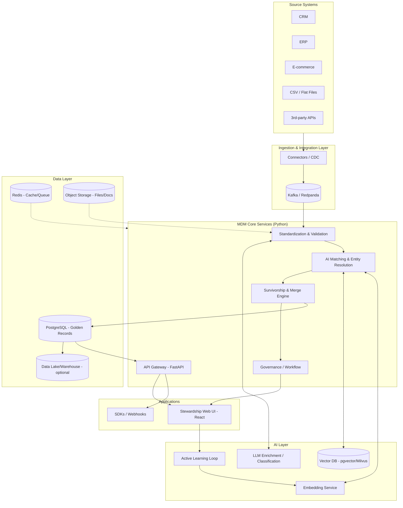

# Multi-Domain MDM SaaS Platform — Architecture & Tech Stack Design

**Version:** 0.1 (Draft)
**Stack focus:** Python-first backend, AI-augmented data quality & stewardship
**Scope:** Multi-domain Master Data Management (Customer, Product, Vendor, Location, Employee, and extensible custom domains)

---

## 1. Executive Summary

This document lays out the architecture for a multi-tenant SaaS Master Data Management (MDM) platform. The system ingests data from multiple source systems, resolves entities across domains (dedupe, match, merge), maintains a governed "golden record," and exposes clean, trusted master data via APIs and sync connectors — all wrapped in a stewardship UI for human-in-the-loop review.

The differentiator is a native **AI layer**: LLM- and embedding-based entity resolution, automated data classification/enrichment, anomaly detection, and an active-learning feedback loop that gets smarter as stewards approve/reject match suggestions — instead of relying purely on hand-tuned fuzzy-matching rules.

---

## 2. Goals & Non-Goals

**Goals**
- Support multiple master data domains (Customer/Party, Product, Vendor/Supplier, Location, Employee) on one shared platform, with domain-specific schemas layered on a common core.
- Multi-tenant SaaS: strict tenant isolation, per-tenant configuration, usage-based billing hooks.
- AI-assisted matching/deduplication that beats classic deterministic + fuzzy rules, while remaining explainable to stewards.
- Full data lineage and audit trail (who/what/when changed a golden record, and why).
- API-first: everything the UI does is available via REST/GraphQL for integration into ERPs, CRMs, data warehouses.
- Human-in-the-loop governance — AI proposes, stewards dispose (with a path to auto-approve above a confidence threshold, tenant-configurable).

**Non-Goals (v1)**
- Not a full data catalog / metadata management tool (though it exposes lineage).
- Not a BI/analytics platform — MDM feeds clean data *into* analytics, doesn't replace it.
- Not attempting real-time (sub-second) master data sync in v1; near-real-time (seconds–minutes) is the target.

---

## 3. High-Level Architecture



**Flow in words:**
1. Source systems push/are polled for data via connectors (batch or CDC).
2. Records land on a message bus, get standardized (address/name/phone normalization, schema mapping to the canonical domain model).
3. The AI Matching engine blocks, scores, and clusters candidate duplicates using a hybrid of deterministic rules + embedding similarity + optional LLM adjudication for ambiguous cases.
4. The Survivorship engine merges matched clusters into a golden record using configurable field-level survivorship rules (most recent, most trusted source, most complete, AI-suggested).
5. Low-confidence matches route to the Stewardship UI for human review; steward decisions feed back into the Active Learning loop to improve future matching.
6. Golden records are served via API/webhooks/sync connectors back to consuming systems.

---

## 4. Core Domain Model

A common **entity envelope** wraps every domain-specific payload so the platform can apply the same matching/governance/lineage machinery regardless of domain:

```
Entity
 ├── entity_id (golden record UUID)
 ├── domain (customer | product | vendor | location | employee | custom:<name>)
 ├── tenant_id
 ├── source_records[]        # one per contributing source system
 │     ├── source_system
 │     ├── source_record_id
 │     ├── raw_payload (JSONB)
 │     ├── ingested_at
 │     └── confidence_score
 ├── attributes (JSONB, domain-schema-validated)
 ├── match_cluster_id
 ├── survivorship_metadata    # which source won each field, and why
 ├── lineage[]                # full change history
 ├── status (pending | active | merged | deprecated | disputed)
 └── ai_metadata
       ├── embedding_ref
       ├── match_confidence
       ├── anomaly_flags[]
       └── enrichment_suggestions[]
```

Each **domain** (Customer, Product, etc.) defines a JSON Schema for `attributes`, plus domain-specific matching config (which fields to block on, which similarity functions to use, survivorship rules per field). This keeps the core engine domain-agnostic while allowing tenants to extend or add custom domains.

---

## 5. AI Capabilities — Detail

This is the core differentiator, so it's worth breaking out field by field.

### 5.1 Entity Resolution / Matching
- **Blocking:** cheap candidate-generation pass (e.g., phonetic keys, n-gram indexing, or ANN search over embeddings) to avoid O(n²) comparisons — critical at SaaS multi-tenant scale.
- **Similarity scoring:** hybrid of
  - Deterministic rules (exact match on tax ID, email, SKU+source).
  - Classic fuzzy string similarity (Jaro-Winkler, Levenshtein) for names/addresses via `rapidfuzz`.
  - **Semantic embeddings** (sentence-transformers or an LLM embedding endpoint) capturing similarity that string-distance misses (e.g., "Bob's Hardware Inc." vs "Robert's Hardware Company").
- **Classifier / scorer:** a gradient-boosted model (LightGBM/XGBoost) or a small learned model trained on labeled match/no-match pairs, taking the above signals as features and outputting a calibrated match probability. This is more maintainable and explainable than an end-to-end black-box LLM call for every pair.
- **LLM adjudication (selective):** only for the ambiguous middle band (e.g., 0.4–0.7 confidence) where a large model can reason over context ("these are probably the same company despite different addresses because one is a subsidiary listed in the notes field") — used sparingly to control cost.

### 5.2 Survivorship Intelligence
- Rule-based survivorship (most recent, most trusted source, most complete) as the default.
- AI-assisted survivorship for fields where rules disagree: an LLM can review conflicting values with source context and recommend + explain a choice, which a steward approves.

### 5.3 Data Standardization & Enrichment
- Address parsing/normalization (libpostal or a hosted API), phone/email normalization, name parsing.
- **LLM-based classification/enrichment:** e.g., inferring an industry code (NAICS/SIC) from a free-text company description, normalizing product categories against a taxonomy, flagging likely data entry errors.
- All AI enrichment suggestions are stored as *suggestions* with confidence scores — never silently overwrite source data without an audit trail.

### 5.4 Anomaly & Drift Detection
- Statistical/ML monitoring on incoming data (schema drift, sudden change in match rates, spike in duplicate clusters) to alert data stewards before bad data pollutes golden records.

### 5.5 Active Learning Loop
- Every steward decision (confirm match / reject match / edit survivorship) is logged as a labeled training example.
- Periodic (e.g., nightly) retraining or fine-tuning of the match-scoring model per tenant (or a shared base model + tenant-specific calibration) so match quality improves over time without manual rule-tuning.

---

## 6. Tech Stack (Python-first)

| Layer | Choice | Why |
|---|---|---|
| API layer | **FastAPI** | Async, typed, auto OpenAPI docs, plays well with Pydantic for schema validation of domain models |
| Task orchestration | **Temporal** (or Celery + Redis for simpler v1) | Long-running, resumable workflows for matching/merge jobs, retries, human-in-loop pauses |
| Message bus | **Kafka** (or **Redpanda** for lower ops overhead) | Decouples ingestion from processing; supports CDC connectors (Debezium) |
| Primary datastore | **PostgreSQL** | JSONB for flexible domain attributes + relational integrity for core entity/lineage tables |
| Vector search | **pgvector** (start) → **Milvus/Qdrant** (scale) | Embedding similarity search for entity resolution blocking |
| Cache/queue | **Redis** | Session cache, rate limiting, lightweight job queues |
| Object storage | **S3-compatible** (AWS S3 / MinIO for self-host) | Source file attachments, exports, audit archives |
| ML/AI | **LightGBM/XGBoost** (match scoring), **sentence-transformers** (embeddings), **Claude API** (LLM adjudication, enrichment, NLP tasks) | Balance of explainable classic ML + LLM reasoning where it adds value |
| Data validation | **Pydantic v2** + **JSON Schema** per domain | Enforce domain schemas at ingestion and API boundaries |
| Frontend | **React + TypeScript**, component library (e.g., shadcn/ui), **TanStack Query** | Stewardship UI, match review queues, dashboards |
| Auth | **Auth0 / Ory / Keycloak** (don't roll your own) | SSO, RBAC, multi-tenant auth out of the box |
| Multi-tenancy | **Schema-per-tenant** in Postgres for mid-size tenants; **row-level with tenant_id + RLS** for smaller/high-density tenants | Balance isolation vs. operational overhead — hybrid model scales better than one-size-fits-all |
| Infra | **Docker + Kubernetes**, **Terraform** for IaC | Standard cloud-portable deployment |
| Observability | **OpenTelemetry**, **Prometheus/Grafana**, **Sentry** | Tracing across async pipelines is essential given the multi-stage matching workflow |
| CI/CD | **GitHub Actions** + **ArgoCD** (GitOps) | — |

---

## 7. Multi-Tenancy & Security

- **Isolation:** hybrid schema-per-tenant (Postgres) with row-level security as a defense-in-depth backstop; tenant_id propagated through every service call and enforced at the DB layer, not just app logic.
- **Encryption:** at-rest (DB + object storage), in-transit (TLS everywhere), field-level encryption for PII-sensitive attributes (configurable per domain schema).
- **RBAC:** roles like Data Steward, Domain Admin, Tenant Admin, API Consumer (read-only), scoped per domain per tenant.
- **Compliance posture:** design for SOC 2 Type II and GDPR from day one — this mainly means: full audit logs (immutable), data residency options, right-to-be-forgotten workflows (which is nontrivial in MDM since golden records span sources — needs a dedicated "tombstone + purge" process).
- **AI-specific:** no tenant data used to train shared/global models without explicit opt-in; per-tenant model isolation or clear contractual boundaries if using a shared base model with tenant fine-tuning layers.

---

## 8. API Surface (indicative)

- `POST /v1/{domain}/records` — ingest raw source record
- `GET /v1/{domain}/entities/{id}` — fetch golden record + lineage
- `GET /v1/{domain}/entities/{id}/matches` — candidate matches + confidence
- `POST /v1/{domain}/entities/{id}/merge` — confirm/execute merge
- `POST /v1/{domain}/entities/{id}/split` — undo an incorrect merge
- `GET /v1/{domain}/review-queue` — steward's pending review items
- `POST /v1/webhooks` — subscribe to golden-record change events
- `GET /v1/lineage/{entity_id}` — full audit trail
- GraphQL endpoint for flexible cross-domain queries (e.g., "all products supplied by vendors in this region")

---

## 9. Deployment Topology

- **Control plane:** shared services (auth, billing, tenant provisioning, model registry).
- **Data plane:** per-tenant-tier isolation — smaller tenants share compute pools (namespace-isolated in K8s), larger/enterprise tenants can get dedicated node pools or even dedicated clusters for compliance reasons.
- **Async processing:** matching/merge jobs run as Temporal workflows on worker pools that autoscale independently from the API layer — matching is the most compute-intensive part of the system and shouldn't compete with API latency SLAs.

---

## 10. Suggested Roadmap (Phased)

**Phase 1 — Single-domain MVP (Customer)**
- Core entity model, ingestion API, deterministic + fuzzy matching, basic survivorship, minimal stewardship UI, single-tenant deployable.

**Phase 2 — AI matching + multi-domain**
- Add embedding-based matching, LightGBM match scorer, Product + Vendor domains, active learning feedback loop.

**Phase 3 — SaaS hardening**
- Multi-tenancy, RBAC/SSO, billing integration, audit/compliance features, connector marketplace (CRM/ERP integrations).

**Phase 4 — Advanced AI**
- LLM-based enrichment/classification, anomaly detection, natural-language query interface over master data ("show me all duplicate vendors created this month with >90% confidence").

---

## 11. Open Questions to Resolve Before Build

- Which source systems are priority integrations for v1 (Salesforce? SAP? Shopify? flat file only)?
- Target initial scale (records per tenant, number of tenants) — this affects whether pgvector is sufficient or Milvus is needed from day one.
- Compliance requirements at launch (GDPR only, or also HIPAA/SOC2 immediately)?
- Self-hosted/on-prem option needed for enterprise customers, or pure SaaS only?
- Build vs. buy for address standardization (libpostal self-hosted vs. a paid API like SmartyStreets/Loqate)?

---

*Next step: once tech stack and domain priorities are confirmed, this doc can be broken into an implementation plan (data models, API contracts, and a working Phase 1 prototype).*
